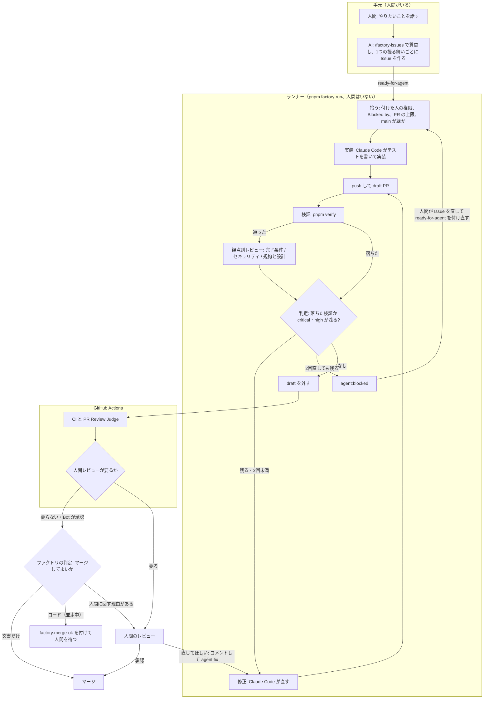
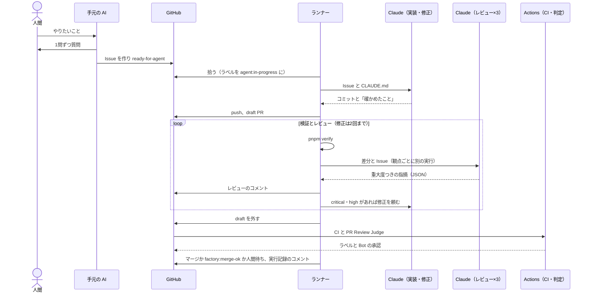

# ソフトウェアファクトリ

Issue に `ready-for-agent` を付けると、ランナーが拾って AI に実装させ、観点別レビューと修正のループを回し、判定まで進めた PR を出す仕組み

- 人間が必ずするのは、手元で AI と Issue を作ることだけ
- 人間がほかに入るのは、判定で人間に回った PR のレビューと、止まった Issue の手直し
- 記録はすべて GitHub（Issue、PR、コメント、ラベル、Actions）に残る
- 判断の理由は [decisions.md](decisions.md)、評価と成長の仕組みは [evaluation.md](evaluation.md)、作った経緯は [worklog.md](worklog.md)

## 全体の流れ



## 1件の流れ



## 使い方

```bash
pnpm factory run            # 拾える Issue と agent:fix の PR を1回処理する
pnpm factory run --watch 5  # 5分おきに回し続ける
pnpm factory issue 23       # 1件だけ
pnpm factory metrics        # GitHub の実行記録から指標を出す
pnpm factory eval           # このワークツリーのプロンプトで eval を回す
pnpm factory retro          # ふりかえりの PR を出す
pnpm factory auth           # Claude の課金先の API キーを確かめる
```

- Issue は手元で Claude Code に `/factory-issues` と頼んで作る（[skill](../../.claude/skills/factory-issues/SKILL.md)）
- ランナーは、このリポを clone した端末で動かす。要るもの:
  - Node 22.18 以上（TypeScript をそのまま実行する）
  - `gh` のログイン（Issue、PR、ラベルの操作と push の名義）
  - `claude` と API キー。Claude の課金は `factory/config.json` の `auth.apiKeyEnv` が指す環境変数の API キーに固定している（既定は `ANTHROPIC_API_KEY`）。claude.ai のログインは使わない。キーがなければ起動前に止まる。`pnpm factory auth` で確かめられる
- ランナーの状態（ワークツリー、ログ、eval の結果）は `.factory/` に置く。git には入れない

## ラベル

| ラベル | 付けるもの | 意味 |
|---|---|---|
| `ready-for-agent` | 人間（手元の AI が人間のアカウントで付ける） | ファクトリに任せてよい。付け直すとやり直す |
| `agent:in-progress` | ランナー | 作業中 |
| `agent:blocked` | ランナー | 止まった。理由は Issue か PR のコメント |
| `agent:fix` | 人間（PR に付ける） | 前回の実行より後の人間のコメントを AI に直させる |
| `factory:merge-ok` | ランナー | 並走中: ファクトリは自動マージしてよいと判定した |
| `needs-human-review` / `skip-human-review` | PR Review Judge | 人間のレビューが要るか |

## 何が残るか

| 段階 | 残るもの | 場所 |
|---|---|---|
| Issue を作る | 受け入れ条件、範囲外、Blocked by、調べたこと | Issue |
| 着手 | 着手のコメント（実行の ID とファクトリのコミット） | Issue |
| 実装 | ブランチ、コミット、「実装した AI が確かめたこと」 | PR |
| レビュー | 観点ごとの指摘と受け入れ条件ごとの判定 | PR のコメント |
| 修正 | 指摘ごとに「直した / 直していない」と理由 | PR のコメント |
| 判定 | PR Review Judge の結果、Bot の承認、CI | PR |
| 終わり | 実行記録（結果、修正の回数、費用、時間、判定の理由を JSON で） | PR のコメント |
| 細かいログ | 各段階の Claude Code の全やりとり | ランナーの `.factory/logs/` |

## 設定

[`factory/config.json`](../../factory/config.json) にある。ランナーは main にある設定とプロンプトを読むので、PR の中で書き換えても、その PR の判定には効かない

- `merge.mode`: `shadow`（並走。文書だけの PR はマージし、コードの PR は `factory:merge-ok` を付けて人間を待つ）、`on`（条件を満たせばマージ）、`off`
- `humanReviewGlobs`: 触れたら必ず人間に回すパス。PR Review Judge の critical path と同じ並びにしてあり、ずれはテストで検出する
- `maxFixRounds`: 修正の上限（2）
- `maxOpenAgentPRs`: 同時に開いておくファクトリの PR の上限（3）
- `models` と `budgetsUsd`: 段階ごとのモデルと費用の上限

## 安全のための決めごと

- エージェントに渡すツールは、ファイルの読み書きと決まったコマンド（`pnpm verify` などと git のコミット）だけ。push、`gh`、ネットワーク、`.env` は渡さない
- 権限のない人が `ready-for-agent` を付けた Issue は拾わない。権限のない人のコメントはエージェントに渡さない（public リポなので）
- main の検証が落ちているときは着手しない
- 自動マージは、PR Review Judge の判定と Bot の承認、CI の成功、ファクトリの判定（人間レビュー必須のパスに触れない、差分 1000 行未満、critical・high なし）がすべてそろったときだけ
