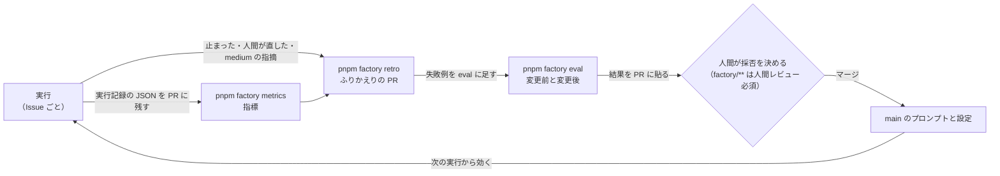

# ファクトリの評価と成長の仕組み

ファクトリが役に立っているかは、実行記録の指標で見る。ファクトリを変えるときは、eval で前後を比べてから人間が採否を決める。うまくいかなかった実行は、ふりかえりでプロンプト・規約・eval に戻す



## 何を測るか

他社の測り方は、結果、人の負担、歯止めの 3 つに分かれる。結果だけを追うと、人の時間が減ったのか移っただけなのかが分からない。Anthropic の Claude Code チームは、リバート率と障害率を歯止めとして組で見ている（[claude.dev, 2026-10-15](https://claude.dev/blog/solving-code-review-at-anthropic/)）

| 種類 | 指標 | このファクトリでの出し方 | 今の対応 |
|---|---|---|---|
| 結果 | 人間の関門かマージまで進んだ割合 | 実行記録の `outcome` | `pnpm factory metrics` |
| 結果 | 修正なしで通った割合、修正の回数 | 実行記録の `fixRounds` | `pnpm factory metrics` |
| 結果 | 時間の中央値、1件あたりの費用 | 実行記録の `steps`（Claude Code の `total_cost_usd` と時間） | `pnpm factory metrics` |
| 人の負担 | 人間が `agent:fix` で戻した回数 | 実行記録の `kind: fix` | `pnpm factory metrics` |
| 人の負担 | 並走の一致（`factory:merge-ok` を付けた PR を人間がそのままマージしたか） | PR のラベルと状態 | `pnpm factory metrics` |
| 人の負担 | zero-touch（作成後に人のコメント・コミットがないままマージ） | PR のタイムライン | まだない |
| 歯止め | リバート、バグの Issue と結び付いた PR | タイトルの revert と、バグの Issue に書く `caused-by #PR` | まだない |
| レビュー | 観点ごとの指摘の件数（重大度別） | 実行記録の `findings` | `pnpm factory metrics` |
| レビュー | 指摘が正しかったか | 人間に回った PR で、指摘ごとに「直した / 誤り / 意図した動作 / どうでもよい」を付ける（Anthropic の 4 分類） | まだない |

読み方

- 件数が少ないうちは、週ごとの率の上下を読まない。直近 20 件で率と件数を並べ、1 件ずつ読むことを主にする（gh-aw の最小件数の既定が 20 件）
- マージ率や zero-touch を目標にしない。歯止め（リバート、バグ）と組で見る

## ファクトリ自体の評価（eval）

他社は「過去の失敗から作った小さな集合を、変更のたびに流す」形にそろっている。Anthropic は実際の失敗から 20〜50 件で始めるよう勧め、ServiceNow や Snowflake は自社のマージ済み PR から隠しテスト付きの課題を作っている。オンラインの A/B テストは件数が少ないと結論が出ない（gh-aw は 54 件回して採用 0 件）

| eval | 中身 | 置き場所 | 今の件数 |
|---|---|---|---|
| 判定規則 | 判定の入力（指摘、検証の結果、差分のパスと行数）と期待する判定の表。モデルを呼ばない | `factory/src/decide.test.ts` | 12 件。実際の実行記録から足していく |
| レビュー | 仕込んだ不具合を見つけるか、無害な変更を指摘しないか | `factory/evals/reviews/` | 2 件（RLS を通らない admin クライアント、表記の変更） |
| 実装 | Issue と同じ形の課題を実装させ、AI に見せない隠しテストで合否を見る | `factory/evals/tasks/` | 2 件（経過日数の表示、体重の差の表示） |

```bash
pnpm factory eval                      # すべて
pnpm factory eval elapsed-days         # 1件だけ
```

- eval は、このワークツリーにあるプロンプトを使う。変える前の main で 1 回、変えたブランチで 1 回流して比べる
- 結果は `.factory/evals/<日時>.json` に残る
- 実装の隠しテストは `TZ=UTC` で回す。手元は日本時間なので、タイムゾーンの不具合が隠れるため

### 改善を採用する条件

1. 先に失敗例を eval に足し、今の版で落ちることを確かめる
2. ファクトリの変更（プロンプト、観点、CLAUDE.md、判定規則、設定）は PR にする。`factory/**` は人間レビュー必須なので自動マージされない
3. 次をそろえてからマージする
   - 判定規則の表のテストがすべて通る
   - 前の版で通っていた eval が、新しい版でも通る
   - 狙った例が通る
   - 無害な変更への誤った指摘が増えない
   - 費用の中央値が大きく増えない。増えるなら理由を PR に書く
4. 判定を緩める変更（人間に回すパスを減らす、`merge.mode` を `on` にする）は、新旧の判定を並べてコメントだけ出す期間を置き、人間が直したか戻した PR が出なくなってから入れる

## 成長のループ

`pnpm factory retro` を 1〜2 週に 1 回回す

1. 前回からの実行記録、止まった理由、人間に回した理由、人間のコメントを集める
2. 回数のかかった実行、止まった実行、人間が直した実行のパターンを探し、防げた最小の変更をプロンプト・CLAUDE.md・eval に入れる
3. `docs/factory/retro/<日付>.md` に材料と「変えたこと」を残し、PR にする
4. 人間が、その PR で eval を前後比べてからマージする

他社との対応

- 失敗を 1 件ずつ仕組み（lint、テスト、skill、指示ファイル、レビュー観点）に戻す形は、メルペイ、Devin、gh-aw、Anthropic、OpenAI に共通する。違いは承認の仕方で、このファクトリは人間が承認する
- 指示を足すことにも費用がある。リポの指示ファイルで成功率は一般には上がらず、推論費用が 20% 超増えたという研究がある。足した行には、どの失敗のために足したかを残し、eval と結び付かない行は消す候補にする
- 落とし穴として、壊れた課題（OpenAI は SWE-bench Pro の約 30% が壊れていると推定）、テストのすり抜け、黙って空回りするループ（gh-aw の skill 改善ワークフローは数か月 dry-run のまま削除された）がある。eval の課題は参照実装で通ることを確かめてから入れ（この 2 件は確かめた）、ふりかえりが 0 件のまま続いたら疑う

## まだないもの

- zero-touch と、マージ後のリバート・バグの追跡（`caused-by #PR` の決まり）
- 指摘ごとの 4 分類（直した / 誤り / 意図した動作 / どうでもよい）
- eval の件数（各 20 件まで）と、1 件を 3 回流して揺れを見ること
- ランナーをコンテナに入れること。今はツールを絞ったうえで手元で動かしている
